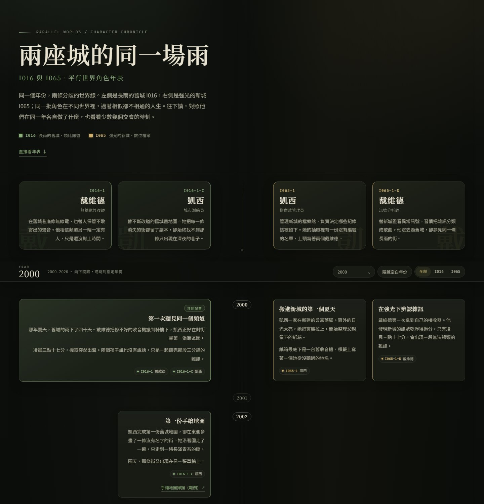

# 平行世界角色年表

以「中央垂直時間軸 × 左右角色分欄」呈現平行世界故事的靜態年表。
內容集中在 `data/story.json`，由一支純 Python 標準庫的 `build.py` 產生可直接放上 GitHub Pages 的 `docs/`。

- 左側：`I016` 世界線（`I016-1 戴維德`、`I016-1-C 凱西`）
- 右側：`I065` 世界線（`I065-1 凱西`、`I065-1-D 戴維德`）
- 年份：2000 年到「現在」（建置時自動計算）
- 深色底、低彩度苔綠與暗金配色；版面與資料分離，CSS 獨立成表



## 功能

- 每年一列，沒有事件的年份也保留在時間軸上
- 角色名稱與簡介卡固定在年表上方，對應各自的欄位
- 單一角色事件、同世界線多人合併事件（可設定共同底色）
- 用 `row` 指定同年事件的上下順序；相同 `row` 的跨世界線事件會在同一列等高對齊
- 跨世界線的「交會」事件放在中央欄，可與同列左右事件並排
- 事件文字可分段，可附加多個外部／內部連結
- 年份快速跳轉、目前年份顯示、預設隱藏空白年份（可切換）、聚焦單一世界線
- 桌面版左右分欄；手機版時間軸靠左、所有事件單欄堆疊
- 不需要資料庫、不需要 npm、不需要任何 Python 套件

## 快速開始

需求：Python 3.10 以上。

```powershell
python build.py
python serve.py
```

開啟 <http://127.0.0.1:8000/> 預覽。
也可以指定埠號，或讓它自動開啟瀏覽器：

```powershell
python serve.py 8080 --open
```

`build.py` 會驗證資料，有問題時會一次列出所有錯誤，不會產生半套網站。

## 目錄結構

```text
.
├── build.py              # 讀取 JSON、驗證、產生 docs/
├── serve.py              # 本機預覽伺服器（無快取）
├── data/
│   └── story.json        # ★ 所有文字內容都在這裡
├── site/
│   ├── index.html        # HTML 外殼與 {{...}} 佔位符
│   ├── style.css         # 版面、配色、響應式樣式
│   └── app.js            # 年份跳轉、聚焦、精簡模式
├── docs/                 # 產生結果，直接作為 GitHub Pages 來源
│   ├── index.html
│   ├── .nojekyll
│   └── assets/
│       ├── style.css
│       └── app.js
└── README.md
```

`docs/` 是產物。請修改 `data/` 與 `site/`，再重新執行 `python build.py`；直接改 `docs/` 會在下次建置時被覆蓋。

## 編輯內容：`data/story.json`

### 1. 網站基本資料

```json
"site": {
  "lang": "zh-Hant",
  "title": "兩座城的同一場雨",
  "subtitle": "I016 與 I065．平行世界角色年表",
  "eyebrow": "Parallel Worlds / Character Chronicle",
  "intro": "顯示在標題下方的導言。",
  "description": "給搜尋引擎與社群卡片用的摘要。",
  "startYear": 2000,
  "endYear": null,
  "footer": "頁尾說明。"
}
```

| 欄位 | 說明 |
| --- | --- |
| `startYear` | 年表起點，預設 2000 |
| `endYear` | 年表終點；`null` 或 `"now"` 代表建置時的當年 |
| `eyebrow` | 標題上方的小字，可留空 |
| `intro` | 首頁導言，可留空 |
| `description` | `<meta name="description">` 與社群摘要 |
| `footer` | 頁尾說明，可留空 |

> 年表終點是動態的。明年重新建置時，會自動多出一列新年份。

### 2. 世界線 `worlds`

目前設計為「左、右各一條世界線」，一條世界線對應一側。

```json
{
  "id": "I016",
  "name": "世界線 I016",
  "side": "left",
  "tone": "moss",
  "note": "長雨的舊城．類比訊號"
}
```

- `side`：只能是 `"left"` 或 `"right"`，同一側只能有一條世界線。
- `tone`：`"moss"`、`"amber"` 或 `"shared"`，決定該世界線的預設顏色。
- `note`：顯示在首頁圖例中的簡短描述。

### 3. 角色 `characters`

```json
{
  "id": "i016-1",
  "code": "I016-1",
  "name": "戴維德",
  "watermark": "D",
  "world": "I016",
  "lane": 2,
  "role": "無線電修復師",
  "summary": "顯示在角色卡上的簡單介紹。"
}
```

- `id`：事件用它來引用角色，必須唯一。
- `code`：畫面上顯示的完整代號，例如 `I016-1-C`。
- `watermark`：角色卡底圖文字；可填一字或自訂文字。省略時使用 `name` 的第一個字。
- `world`：對應 `worlds[].id`。
- `lane`：1 代表最靠近中央時間軸的欄位，2 是外側，依此類推。
  省略時會自動補上最小的空位。同一側的 `lane` 必須從 1 開始連續。
- `role`、`summary`：角色卡上的職稱與介紹；`summary` 可用 `\n` 換行，連續兩個換行會留出空行。

左側的視覺順序是「外側 → 內側」，右側是「內側 → 外側」，所以兩邊會自然鏡射。
預設四位角色的 `lane` 安排是：

| 世界線 | 角色 | lane |
| --- | --- | --- |
| I016（左） | I016-1 戴維德 | 1（內側） |
| I016（左） | I016-1-C 凱西 | 2（外側） |
| I065（右） | I065-1 凱西 | 1（內側） |
| I065（右） | I065-1-D 戴維德 | 2（外側） |

### 4. 事件 `events`

```json
{
  "id": "evt-2025-i016-funeral",
  "year": 2025,
  "row": 2,
  "characters": ["i016-1", "i016-1-c"],
  "title": "葬禮",
  "tone": "moss",
  "body": "第一段文字。\n\n第二段文字。",
  "links": [
    {
      "label": "參考資料（範例）",
      "url": "https://example.com/reference"
    }
  ]
}
```

| 欄位 | 說明 |
| --- | --- |
| `id` | 可省略；省略時自動產生。只能使用英數、`_`、`-`，且以字母開頭 |
| `year` | 事件開始年份，必須在年表範圍內 |
| `endYear` | 可省略；跨年份時填結束年份（含） |
| `row` | 可省略；同一年的列序。數字越小越上面，相同數字代表同一列（左右等高），可跳號 |
| `characters` | 角色 `id` 陣列，至少一位 |
| `title` | 標題，可省略 |
| `body` | 字串或字串陣列；空行分段 |
| `links` | 選填；`label` + `url`，可多個 |
| `tone` | 選填；`moss`、`amber`、`shared`、`bridge` |

**跨年份事件**會放在 `year` 那一列，並在卡片上標示 `2003–2004`；它不會在畫面上拉長成一個區塊。

**同一年、同一角色有多個事件**時，未指定 `row` 會自動往下堆疊，不會互相重疊；需要和另一側事件等高時，請使用下一節的 `row`。

### 合併與交會的三種情況

| 事件角色 | 呈現方式 |
| --- | --- |
| 同一個世界線的 1 位角色 | 單欄卡片，對齊該角色的欄位 |
| 同一個世界線的 2 位以上角色 | 合併卡片，橫跨該側所有相關欄位；預設使用世界線的底色 |
| 左右兩側都有角色 | 「世界線交會」卡片，橫跨整個年表寬度 |

要讓合併卡片使用不同的共同底色，在事件加上 `"tone": "shared"`（或 `"moss"`、`"amber"`）。

「合併」和「同一列對齊」是兩件事：合併會把角色放在同一張卡片裡；如果只是要讓不同角色的事件在同一高度並排，保留各自的事件，設定相同的 `row` 即可。

### 指定上下順序與跨世界線等高：`row`

`row` 是「同一年內的垂直列序」，不是 HTML 的 row index。數字只用來排序，不需要連續。

- 較小的 `row` 在上面。
- `row` 相同的事件會排在同一列；左右兩側、或同側不同角色欄位，會共用同一條列並等高。
- 沒有設定 `row` 的事件：若該年完全沒有 `row`，維持原本的自動堆疊；若該年已有其他事件設定 `row`，這些未指定的事件會排在所有指定列之後（建置時會顯示提示）。
- `row` 必須是 1 以上的整數；可以跳號，例如 10、20、30，實際顯示時會依排序壓縮。

目前 [data/story.json](data/story.json) 的 2025 年就是使用這個機制：

- `evt-2025-common-lucas`：`row: 1`（交會公告，置於中央欄）
- `evt-2025-i016-funeral`：`row: 2`
- `evt-2025-i065-funeral`：`row: 2`

後兩者雖然是不同世界線的兩張合併卡，但 `row` 相同，所以會在同一列並等高。

假設 2026 年右側 `I065-1` 有三個事件，`I065-1-D` 只有一個對應事件，想讓第三個事件和它同高：

```json
{
  "id": "evt-2026-i065-third",
  "year": 2026,
  "row": 3,
  "characters": ["i065-1"],
  "title": "第三件事",
  "body": "..."
}
```

把 `I065-1-D` 的對應事件也設成 `row: 3`，即使兩者不是合併事件，也會在同一列。卡片高度會以該列較高的一張為準，兩張一起被撐高。

```json
{
  "id": "evt-2026-i065-d-response",
  "year": 2026,
  "row": 3,
  "characters": ["i065-1-d"],
  "title": "另一欄的對應行動",
  "body": "..."
}
```

規則：

- 同一列、同一側、同一 `lane` 不能有兩個事件重疊；`build.py` 會報錯並列出衝突的 id。
- 交會事件橫跨中央欄與左右各一個內側欄；同一 `row` 可以同時放一個交會事件和左右側事件，但不能放兩個交會事件，也不能在交會卡占用的內側欄放其他事件。
- 同一列可以放左右兩側各一個事件，也可以放同一側不同 `lane` 的事件。
- 只影響 `year` 相同的事件；`endYear` 跨年份的事件仍以起始年份為準。

## 修改樣式

主要設定在 `site/style.css` 最上方：

```css
:root {
  --bg: #0d0f0c;
  --surface: #171b14;
  --ink: #e7e1d0;
  --moss: #8fae7d;
  --amber: #cdae6c;
  --axis-w: 7.5rem;
}
```

- `--moss` / `--amber` / `--shared` / `--bridge`：四個色調，事件卡與角色卡共用。
- `--axis-w`：桌面版中央時間軸的寬度。
- `--page-pad`：頁面左右留白。
- 桌面分欄的斷點是 `@media (min-width: 1024px)`，手機版在 `max-width: 640px` 微調。
- 想新增色調（例如 `plum`）時，同步修改：
  1. `site/style.css` 新增 `.tone--plum` 與對應的 `--tone-rgb`
  2. `build.py` 的 `TONES` 加入 `"plum"`

字型預設使用系統的 Noto／PingFang／微軟正黑體與襯線字，不會連外。若要載入 Google Fonts，可在 `site/index.html` 的 `<head>` 加入連結。

## 修改版面或行為

- **HTML 外殼**：`site/index.html`，其中 `{{HERO}}`、`{{CAST}}`、`{{TOOLBAR}}`、`{{TIMELINE}}`、`{{FOOTER}}` 由 Python 替換。
- **HTML 產生邏輯**：`build.py` 的 `render_*` 函式。
- **前端互動**：`site/app.js`。目前包含年份跳轉、scrollspy、精簡模式、世界線聚焦與 `localStorage` 記憶。
- 新增佔位符時，記得同步更新 `build.py` 的 `replacements`；若有未替換的 `{{...}}`，建置會直接報錯。

## 發佈到 GitHub Pages

`docs/` 已經是完整網站，不需要 GitHub Actions。

1. 在 GitHub 建立新 repository，將整個資料夾上傳（`docs/` 也要）。
2. 進入 repository 的 **Settings → Pages**。
3. **Build and deployment → Source** 選 **Deploy from a branch**。
4. Branch 選 `main`（或你的預設分支），資料夾選 **`/docs`**，按 **Save**。
5. 幾分鐘後即可用 `https://<你的帳號>.github.io/<repository>/` 開啟。

日後修改內容的流程：

```powershell
# 編輯 data/story.json 或 site/ 下的檔案
python build.py
git add .
git commit -m "update timeline"
git push
```

GitHub Pages 會自動更新。`docs/.nojekyll` 由建置程式產生，用來避免 Jekyll 處理靜態資源。

### 如果頁面樣式沒有更新

瀏覽器可能快取舊的 CSS。請強制重新整理（Windows：`Ctrl + F5`），或確認 `docs/assets/style.css` 有跟著重新產生。

## 資料驗證與疑難排解

`python build.py` 會檢查：

- JSON 語法與 BOM
- 世界線、角色、事件的必填欄位
- 重複的 id、未知的世界線／角色
- 年份是否落在 `startYear`–`endYear` 之間
- `lane` 是否重複或不連續
- `row` 是否為正整數，以及同一列、同一側是否佔用到同一個 `lane`
- 同一列是否有多個交會事件
- 連結是否使用允許的格式（`http(s)`、`mailto`、`#`、`/`、`./`、`../`）

錯誤訊息會指出位置，例如：

```text
events[7].characters[0]：找不到角色「i016-x」
```

常見原因：

- JSON 最後一項多了逗號，或使用了單引號。
- 角色 `id` 與事件裡的引用不一致。
- `characters` 中的角色分屬左右兩側，卻預期它是一般事件——這其實會變成「交會」卡片。
- 同一列、同一側的兩個事件佔用到同一個 `lane`；請改 `row` 或 lane。
- 同一列有多個交會事件；中央欄同一列只能放一張交會卡。
- 事件年份超過目前年份；若是未來事件，請調整 `site.endYear`。

## 替換示範內容

`data/story.json` 中目前的角色與事件都是虛構示範，連結指向 `example.com`。
直接替換 `title`、`intro`、角色簡介與事件內容即可；不需要改 Python。

## 授權

此框架可自由修改與使用。若要公開發佈，建議依你的需求加入 `LICENSE`（例如 MIT）。
